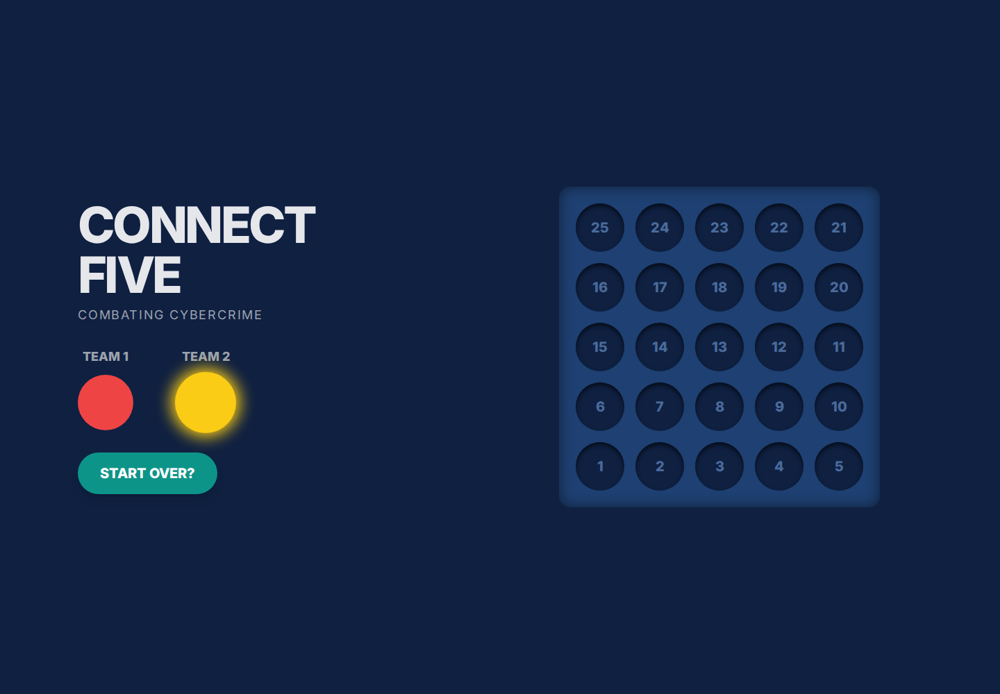

# Combating Cybercrime — Educational Suite

An interactive web-based toolkit designed for learning and practicing English terminology for combating cybercrime, qualifying cyber incidents, and building police reports.

This project was created as part of a scientific research paper during my studies at the Academy of the Ministry of Internal Affairs of the Republic of Belarus.

## Preview

  
  

## Development Method
Rapidly prototyped using AI-assisted development.

## Project Structure
* `index.html` — main navigation dashboard.
* `lesson-1-vocabulary.html` — **Module 1: Core Vocabulary**. Basic cybersecurity terminology: flashcards, British English pronunciation, spelling practice, and a word-matching game.
* `professional-terminology.html` — **Module 2: Professional Terminology**. Types of cybercrimes with English definitions, Russian equivalents, pronunciation, and a timed term-and-definition matching game.
* `police-reports-qualification.html` — **Module 3: Police Reports Qualification**. Qualification of 20 cyber incident reports under time pressure and a passive-voice police report builder.
* `game-connect-five.html` — **Module 4: Review Game "Connect Five"**. Team-based review game using cybersecurity trivia; the first team to link five cells in a row wins.

## Tech Stack
* HTML5 / CSS3 (Tailwind CSS via CDN)
* Vanilla JavaScript
* Web Speech API (used for vocabulary and terminology pronunciation)

## How to Run
No installation or local server setup is required. Simply open `index.html` in any modern web browser.
